# AWS 構成図 (公式ロゴ付き / architecture-beta)

Mermaid v11 の `architecture-beta` 図は Iconify のアイコンパックを読み込めるため、
`logos` パック (https://icon-sets.iconify.design/logos/?query=aws) に収録されている
AWS サービスロゴをそのまま使えます。

```mermaid
architecture-beta
    group aws(logos:aws)[AWS Cloud]
    group vpc(logos:aws-vpc)[VPC] in aws
    group public(cloud)[Public Subnet] in vpc
    group private(cloud)[Private Subnet] in vpc

    service user(internet)[User]
    service r53(logos:aws-route53)[Route 53] in aws
    service waf(logos:aws-waf)[WAF] in aws
    service cf(logos:aws-cloudfront)[CloudFront] in aws
    service s3(logos:aws-s3)[S3 static] in aws
    service alb(logos:aws-elb)[ALB] in public
    service ec2a(logos:aws-ec2)[EC2 1a] in private
    service ec2c(logos:aws-ec2)[EC2 1c] in private
    service rds(logos:aws-rds)[RDS] in private
    junction jin in private
    junction jout in private

    user:R --> L:cf
    r53:B --> T:cf
    waf:T --> B:cf
    cf:B --> T:s3
    cf:R --> L:alb
    alb:R --> L:jin
    jin:T --> B:ec2a
    jin:B --> T:ec2c
    ec2a:R --> L:jout
    ec2c:R --> L:jout
    jout:R --> L:rds
```



## レンダリング方法

### GitHub

GitHub の Mermaid は外部アイコンパックを読み込まないため、`logos:*` は描画されません
(組み込みの `cloud` / `database` / `disk` / `internet` / `server` のみ利用可)。
公式ロゴ付きで共有したい場合は CLI で SVG/PNG に出力してコミットしてください。

### CLI (mermaid-cli)

`@iconify-json/logos` を npm から取得し、その `icons.json` をパック名 `logos` として渡します。
(`--iconPacks @iconify-json/logos` は npx 経由だとパッケージ解決に失敗するため、
`--iconPacksNamesAndUrls` でファイルパスを直接指定しています。)

```sh
cd marmaidtest
npm install --no-save --no-package-lock @iconify-json/logos
npx -y @mermaid-js/mermaid-cli -p puppeteer-config.json \
  --iconPacksNamesAndUrls "logos#file://$PWD/node_modules/@iconify-json/logos/icons.json" \
  -i aws-architecture-icons.md -o rendered/aws-architecture-icons.png -b white -s 2
```

### 制約

- `architecture-beta` は自動レイアウト (fcose) で、`flowchart` ほど配置を細かく制御できません。
  分岐・合流は `junction` を挟むと直線的になりやすいですが、完全には整いません。
- エッジのラベル (`HTTPS (443)` など) は付けられません。
- 図のスタイル (`classDef` / `style`) も使えません。

### VS Code / mermaid.live

- mermaid.live は `logos:` などの Iconify パックを自動で解決するので、そのまま貼り付ければ表示されます。
- VS Code の Markdown プレビュー拡張はパックの読み込みに対応していないものが多く、環境依存です。

### Mermaid をブラウザで直接使う場合

```js
import mermaid from 'mermaid';
mermaid.registerIconPacks([
  { name: 'logos', loader: () => fetch('https://unpkg.com/@iconify-json/logos/icons.json').then(r => r.json()) },
]);
```
