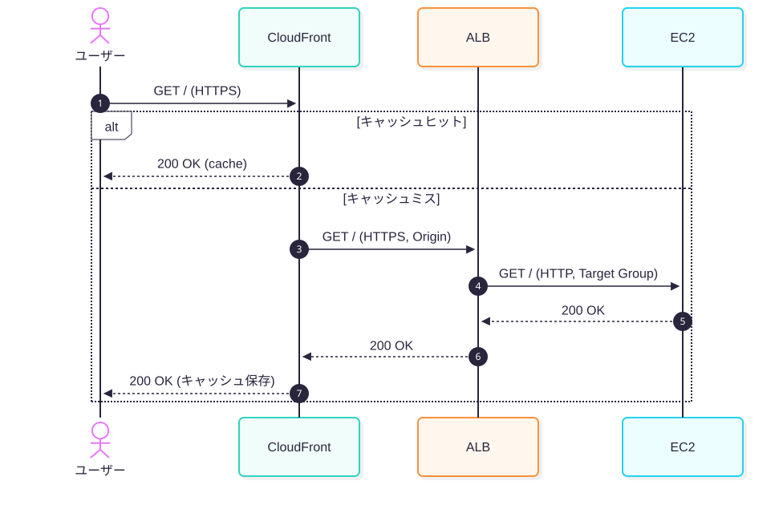

# AWS 構成図 (CloudFront → ALB → EC2)

Mermaid の `flowchart` を使った AWS 構成図のサンプルです。
GitHub / VS Code (Markdown Preview Mermaid Support) などでそのまま描画できます。

## 構成図

## シンプル版 (最小構成)

## リクエストフロー (シーケンス図)

## 補足

- `subgraph` で AWS Cloud / Region / VPC / Subnet の入れ子を表現しています。
- `classDef` / `style` で AWS のサービスカテゴリ配色 (Compute: オレンジ、Network: 紫、Storage: 緑、DB: 青) を模しています。
- 公式の AWS アイコンを使いたい場合は Mermaid 単体では困難なため、`architecture-beta` 図 (Mermaid v11+) や PlantUML / diagrams (Python) の利用を検討してください。
